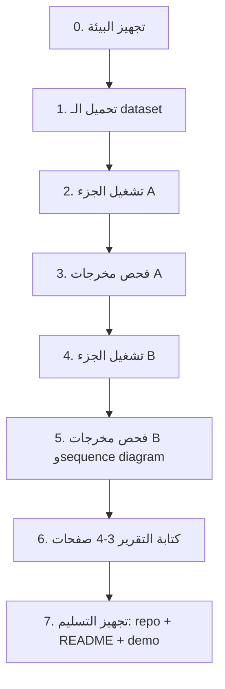

# TP3 — Anonymization & Self-Sovereign Identity

**Dataset:** TON_IoT Network — ملف `train_test_network.csv` (Kaggle: `arnobbhowmik/ton-iot-network-dataset`)
**اللغة:** Python 3.11+ — كل الأدوات مجانية، لا يلزم أي جهاز خاص.

هذا الملف يشرح **ماذا يفعل المشروع، وبأي ترتيب تنفّذه، وماذا يحدث داخل كل سكربت، وكيف تقرأ النتائج وتكتب التقرير.**

---

## فهرس

1. [نظرة عامة وربطها بخطوات الـ TP](#1-نظرة-عامة-وربطها-بخطوات-الـ-tp)
2. [هيكل المشروع](#2-هيكل-المشروع)
3. [تسلسل التنفيذ خطوة بخطوة](#3-تسلسل-التنفيذ-خطوة-بخطوة)
4. [الجزء A من الداخل](#4-الجزء-a-من-الداخل-part_a_anonymizationpy)
5. [الجزء B من الداخل](#5-الجزء-b-من-الداخل-part_b_ssipy)
6. [النتائج الفعلية على الـ dataset](#6-النتائج-الفعلية-على-الـ-dataset)
7. [المعاملات (parameters)](#7-المعاملات-parameters)
8. [حل المشاكل الشائعة](#8-حل-المشاكل-الشائعة)
9. [كتابة التقرير والتسليم](#9-كتابة-التقرير-والتسليم)
10. [أسئلة المناقشة الشفهية](#10-أسئلة-المناقشة-الشفهية)
11. [Real-device option و Bonus و أخلاقيات](#11-real-device-option-وbonus-وأخلاقيات)

---

## 1. نظرة عامة وربطها بخطوات الـ TP

الـ TP3 جزآن: (A) إخفاء هوية dataset حقيقية وقياس المقايضة بين الخصوصية والفائدة، و(B) بناء تدفق هوية ذاتية السيادة. الجدول يربط كل خطوة مطلوبة بمكانها في الحل:

| الخطوة في الـ TP | أين تُنفَّذ | المخرج |
|---|---|---|
| **A1** اختيار dataset | `load_data()` | TON_IoT |
| **A2** identifiers / QIs / sensitive + linkage attack | `QIS`, `SENSITIVE`, `make_aux()`, `linkage_attack()` | `linkage_examples_raw.csv` |
| **A3** k-anonymity (k = 2, 5, 10) | `Anonymizer.search()` و`release()` | `anonymized_k*_l*.csv` |
| **A4** Differential privacy (ε = 0.1, 1, 10) | `dp_grouped()` و`dp_experiment()` | `dp_error_vs_epsilon.csv` |
| **A5** منحنيات utility مقابل privacy | `plot_anon()` و`plot_dp()` | `fig_kanonymity_tradeoff.png`, `fig_dp_tradeoff.png` |
| **B1** ثلاثة أدوار (issuer, holder, verifier) | `Issuer`, `Wallet`, `Verifier/SmartLock` | — |
| **B2** DID + credential موقّع | `Identity`, `did_from_pub()`, `Issuer.issue()` | — |
| **B3** تحقق دون الاتصال بالـ issuer في كل طلب | `resolve_did_key()` + `Verifier.refresh_revocation()` | — |
| **B4** Selective disclosure | salted commitments في `issue()` و`Wallet.present()` | — |
| **B5** Revocation | `Issuer.revoke()` / `revocation_list()` | `results_part_b.json` |
| **B6** مقارنة مع OAuth 2.0 | القسم 5.5 أدناه | — |
| Deliverable: sequence diagram | `docs/sequence_diagram.md` | Mermaid |

---

## 2. هيكل المشروع

```
tp3/
├── README.md                    # هذا الملف
├── requirements.txt             # pandas, numpy, matplotlib, cryptography
├── run_all.sh                   # يشغّل الجزأين بالترتيب
├── part_a_anonymization.py      # الجزء A كاملاً
├── part_b_ssi.py                # الجزء B كاملاً (لا يحتاج الـ dataset)
├── make_demo_data.py            # بيانات اصطناعية للاختبار فقط — لا تستعملها في التقرير
├── docs/
│   └── sequence_diagram.md      # sequence diagram (Mermaid)
└── outputs/                     # يُنشأ تلقائياً عند التشغيل
    ├── summary_part_a.md        # جداول جاهزة للصق في التقرير
    ├── fig_kanonymity_tradeoff.png
    ├── fig_dp_tradeoff.png
    ├── anonymized_k2_l1.csv, anonymized_k5_l1.csv, anonymized_k10_l1.csv
    ├── anonymized_k10_l2.csv, anonymized_k10_l3.csv
    ├── linkage_examples_raw.csv
    ├── dp_error_vs_epsilon.csv
    ├── results_part_a.json
    └── results_part_b.json
```

---

## 3. تسلسل التنفيذ خطوة بخطوة

### المخطط العام



### الخطوة 0 — تجهيز البيئة
```bash
cd tp3
python3 -m venv .venv
source .venv/bin/activate          # على Windows: .venv\\Scripts\\activate
pip install -r requirements.txt
```

### الخطوة 1 — الحصول على الـ dataset
حمّل `train_test_network.csv` من Kaggle (من المتصفح أو عبر `kaggle datasets download -d arnobbhowmik/ton-iot-network-dataset --unzip`) وضعه في أي مكان؛ سنمرّر مساره للسكربت.
الملف: ~211 ألف سجل و44 عموداً، الفاصل `;`، وفيه BOM وأعمدة فارغة زائدة — الكود يتعامل مع ذلك تلقائياً.

### الخطوة 2 — تشغيل الجزء A
```bash
python3 part_a_anonymization.py --data /path/to/train_test_network.csv --sample 0
```
(`--sample 0` = كل السجلات، يستغرق حوالي دقيقة.) السكربت ينفّذ **5 مراحل متسلسلة** وتطبع كل منها رقمها:

| المرحلة | ماذا يحدث | ماذا ستراه في الطرفية |
|---|---|---|
| **[1] loading** | قراءة الملف، تنظيفه، اختيار الأعمدة | عدد السجلات والـ QIs وتوزيع `type` |
| **[2] linkage attack على الأصلي** | حساب نسبة السجلات الفريدة، بناء جدول المهاجم (500 ضحية)، الـ join | `raw data: 49.2% unique` + أمثلة أسماء مع نوع الهجوم المكشوف |
| **[3] k-anonymity** | بحث الـ lattice كاملاً لكل إعداد (k, l)، تطبيق التعميم والحذف، إعادة الهجوم على كل نسخة | سطر لكل إعداد: مستويات التعميم، نسبة الحذف، loss، نتيجة الهجوم |
| **[4] differential privacy** | قصّ القيم، إضافة ضجيج Laplace، 200 تجربة لكل ε | جدول المتوسطات الحقيقية ثم جدول الخطأ مقابل ε |
| **[5] plots + summary** | رسم المنحنيات وكتابة الجداول | `done -> outputs/` |

### الخطوة 3 — فحص مخرجات الجزء A
1. افتح `outputs/summary_part_a.md` — فيه الجدولان الأساسيان للتقرير.
2. افتح الصورتين `fig_kanonymity_tradeoff.png` و`fig_dp_tradeoff.png`.
3. افتح `linkage_examples_raw.csv` — هذا هو "linkage attack demo" (Deliverable).
4. تحقق أن `anonymized_k*_l*.csv` موجودة (Deliverable: الـ dataset المجهّلة).
5. اقرأ القسم [6](#6-النتائج-الفعلية-على-الـ-dataset) لتفسير ما تراه.

### الخطوة 4 — تشغيل الجزء B
```bash
python3 part_b_ssi.py
```
يطبع 10 سيناريوهات؛ كلها يجب أن تظهر `[PASS]` وفي النهاية `ALL SCENARIOS AS EXPECTED: True`. يحفظ النتائج في `outputs/results_part_b.json`.

### الخطوة 5 — sequence diagram
افتح `docs/sequence_diagram.md` (يظهر مرسوماً مباشرة على GitHub/GitLab). إن احتجت صورة للتقرير: الصق كود Mermaid في https://mermaid.live وصدّره PNG.

### الخطوة 6 — كتابة التقرير
اتبع الهيكل في [القسم 9](#9-كتابة-التقرير-والتسليم). الأرقام تأتي من `summary_part_a.md` و`results_part_b.json`.

### الخطوة 7 — التسليم
ضع كل شيء في repository واحد (Git) أو مجلد مشترك، مع هذا الـ README الذي يشرح إعادة إنتاج النتائج، والتقرير، وجهّز demo قصيراً (تشغيل `part_b_ssi.py` ثم عرض الرسمين).

> **اختصار:** `./run_all.sh /path/to/train_test_network.csv` يشغّل الخطوتين 2 و4 معاً.

---

## 4. الجزء A من الداخل (`part_a_anonymization.py`)

### 4.1 تصنيف الأعمدة

| الفئة | الأعمدة | التبرير |
|---|---|---|
| Identifiers (تُحذف قبل النشر) | `dns_query`, `http_uri`, `http_user_agent`, `ssl_subject`, … | تحدد سلوكاً/جهازاً/موقعاً مباشرة |
| **Quasi-identifiers** | `src_ip`, `dst_ip`, `src_port`, `dst_port`, `service` | كل واحد وحده لا يعرّف، لكن **الجمع** بينها فريد في ~49% من السجلات، وقابل للربط بسجلات خارجية (مثل log راوتر). `src_port` المؤقت يعمل كبصمة للتدفق |
| Sensitive attribute | `type` (normal, dos, ddos, scanning, injection, xss, password, backdoor, ransomware, mitm) | ما نريد حمايته: يكشف أن الجهاز مخترَق أو مهاجِم |
| للـ utility | `src_bytes` | تُستعمل في استعلام الـ DP |

> **حد مهم:** هذا الملف لا يحتوي عمود وقت (`ts`) وهو quasi-identifier مهم عادةً، لذلك اعتمدنا `dst_ip` و`src_port`. اذكر ذلك في التقرير.

### 4.2 تحميل البيانات — `load_data()`
1. يقرأ السطر الأول ليكتشف الفاصل (`;` أو `,`) ويتجاوز BOM.
2. يتحقق من وجود الأعمدة المطلوبة، وإلا يطبع الأعمدة الموجودة ويتوقف.
3. يحذف الصفوف الفارغة، ويحوّل المنافذ إلى أرقام، و`service = "-"` إلى `none`، والقيم الناقصة في `type` إلى `unknown`.
4. يعيد فقط: الـ QIs الخمسة + `src_bytes` + `type`.

### 4.3 Linkage attack — `make_aux()` و`linkage_attack()`
- **سيناريو المهاجم:** يملك جدولاً عاماً فيه (اسم، src_ip، dst_ip، src_port، dst_port، service) لـ 500 شخص، **بدون** `type`.
- **الهجوم:** يربط جدوله بالجدول المنشور على الـ QIs (بعد تعميمها بنفس مستويات النسخة المنشورة).
- **مقاييس:**
  - `reidentified_unique_pct`: نسبة الضحايا الذين طابقوا سجلاً واحداً بالضبط.
  - `attribute_disclosed_correct_pct`: نسبة من انكشف `type` الخاص بهم **بشكل صحيح** (كل المرشحين لهم نفس `type` وهو فعلاً صحيح). هذا يشمل الـ **homogeneity attack** حتى لو لم يكن السجل فريداً.
  - `median_candidates`: الوسيط لعدد السجلات المرشحة.

### 4.4 k-anonymity و l-diversity — `class Anonymizer`
**الفكرة:** تعميم الـ QIs (تقليل دقتها) حتى يصبح كل سجل مطابقاً لـ k−1 سجلاً آخر على الأقل (equivalence class)، وحذف الاستثناءات.

**الـ hierarchies (مستويات التعميم):**

| QI | مستوى 0 | 1 | 2 | 3 | 4 |
|---|---|---|---|---|---|
| `src_ip`, `dst_ip` | `192.168.1.38` | `192.168.1.*` | `192.168.*.*` | `192.*.*.*` | `*` |
| `src_port` | `34718` | كتلة 1024 | well-known / registered / dynamic | `*` | |
| `dst_port` | `80` | <1024 كما هي، الباقي `1024+` | well-known / registered / dynamic | `*` | |
| `service` | `http` | `none` / `named` | `*` | | |

**الخوارزمية (`search`):**
1. نولّد كل تركيبات المستويات: 5×5×4×4×3 = **1200** عقدة في الـ lattice.
2. لكل عقدة: نحسب حجم الـ equivalence class لكل سجل (`class_stats`) وعدد قيم `type` المختلفة في كل class (للـ l-diversity).
3. لكل إعداد (k, l): السجلات التي `size < k` أو `distinct types < l` تُحذف (suppression). إن تجاوزت نسبة الحذف `--max-suppress` (5%) تُرفض العقدة.
4. بين العقد المقبولة نختار **أقل information loss**:
   `loss = (1 − s)·Prec + s·1` حيث `Prec` = متوسط (المستوى / أقصى مستوى) و`s` نسبة المحذوف.
5. `release()` يطبّق العقدة المختارة ويكتب الـ CSV المجهّلة.

**الإعدادات المنفّذة:** k = 2, 5, 10 (بدون l)، ثم k=10 مع l ≥ 2 و l ≥ 3.

> **لماذا l-diversity؟** لأن k-anonymity وحدها لا تمنع كشف الخاصية الحساسة إذا كانت كل سجلات الـ class لها نفس القيمة (انظر القسم 6).

### 4.5 Differential privacy — `dp_grouped()`
- **الاستعلام:** متوسط `src_bytes` لكل `service` (8 مجموعات).
- **الآلية (Laplace):**
  1. نقصّ القيم في `[0, B]` حيث `B` = percentile 99 (= 3016 بايت) — لتحديد الـ sensitivity.
  2. المجموع: sensitivity = `B`، ضجيج `Lap(B / (ε/2))`.
  3. العدد: sensitivity = 1، ضجيج `Lap(1 / (ε/2))`.
  4. المتوسط الخاص = المجموع المشوّش ÷ العدد المشوّش.
- **الميزانية:** المجموعات تقسّم السجلات (كل سجل في مجموعة واحدة) ⇒ **parallel composition** ⇒ الميزانية الكلية = ε.
- نكرر 200 مرة لكل ε ونحسب: `MAE` للمتوسط، الخطأ النسبي المجمّع، و`MAE` للعدد.
- يطبع أيضاً المتوسط الحقيقي قبل القصّ وبعده لكل مجموعة ليظهر **انحياز القصّ**.

### 4.6 الرسوم
- `fig_kanonymity_tradeoff.png`: (1) information loss + المحذوف، (2) نجاح الهجوم قبل/بعد، (3) متوسط حجم الـ class.
- `fig_dp_tradeoff.png`: (1) المتوسط الحقيقي مقابل المشوّش لكل ε، (2) الخطأ مقابل ε على مقياس log-log.

---

## 5. الجزء B من الداخل (`part_b_ssi.py`)

### 5.1 الأدوار

| الدور | الكلاس | الشرح |
|---|---|---|
| Issuer | `Issuer` | البلدية؛ توقّع الـ credential وتنشر قائمة الإلغاء |
| Holder | `Wallet` | المستخدم/المحفظة (يمكن تشغيلها على Raspberry Pi) |
| Verifier | `Verifier` / `SmartLock` | القفل الذكي؛ يفتح فقط إذا أثبت الحامل `over_18` |

### 5.2 الكتل التقنية
- **DID:** `did:key` بمفتاح Ed25519 (multicodec `0xed01` + base58btc). **بدون blockchain**، ويُحَلّ **محلياً** (`resolve_did_key`) لأن المفتاح العام هو المعرّف نفسه. لذلك لا يحتاج الـ verifier الاتصال بالـ issuer لمعرفة مفتاحه.
- **Verifiable Credential:** JSON موقّع من الـ issuer: `iss, sub (holder DID), jti, iat, exp, _sd`.
- **Selective disclosure (على طريقة SD-JWT):**
  - لكل attribute: `disclosure = base64([salt, name, value])`، و`digest = SHA-256(disclosure)`.
  - الـ issuer يوقّع **الـ digests فقط**. الـ salt العشوائي يمنع تخمين القيم (بدونه يمكن تخمين `over_18 = true/false` من الـ digest).
  - تُضاف digests وهمية (decoys) وتُخلط لإخفاء عدد الخصائص وترتيبها.
  - الحامل يكشف الـ disclosures التي يريدها فقط.
- **Key binding:** الحامل يوقّع (nonce من الـ verifier + audience + hash للعرض) بمفتاحه الخاص ⇒ سرقة الـ credential لا تفيد بدون المفتاح الخاص.
- **Replay protection:** كل nonce يُستعمل مرة واحدة.
- **Revocation:** الـ issuer ينشر **قائمة موقّعة** بالـ `jti` الملغاة؛ الـ verifier يحمّلها **دورياً** ويخزّنها (لا اتصال مع كل طلب).

### 5.3 تسلسل التنفيذ داخل `main()`
1. إنشاء issuer وحاملين (Alice وMallory) وقفل ذكي يثق بالـ issuer فقط.
2. الـ issuer يصدر credential لـ Alice (4 خصائص + 2 decoys).
3. القفل يحمّل قائمة الإلغاء (اتصال رقم 1 بالـ issuer).
4. تشغيل السيناريوهات العشرة، كل واحد يطلب nonce جديداً من القفل ثم يعرض.
5. السيناريو 10: الـ issuer يلغي الـ credential، القفل يحدّث القائمة (اتصال رقم 2)، ثم يُرفض العرض.
6. طباعة الملخص وحفظ `results_part_b.json`.

### 5.4 السيناريوهات العشرة

| # | السيناريو | المتوقع | سبب الرفض / ملاحظة |
|---|---|---|---|
| 1 | credential صالح، كشف `over_18` فقط | UNLOCKED | الـ verifier لا يرى الاسم ولا تاريخ الميلاد |
| 2 | كشف خاصيتين | UNLOCKED | |
| 3 | عدم كشف الخاصية المطلوبة | DENIED | policy |
| 4 | disclosure مزوّر | DENIED | الـ digest غير موجود في `_sd` |
| 5 | إعادة إرسال عرض قديم | DENIED | nonce مستعمل (replay) |
| 6 | credential مسروق عند حامل آخر | DENIED | توقيع key-binding غير صالح |
| 7 | issuer غير موثوق | DENIED | |
| 8 | credential منتهي | DENIED | `exp` |
| 9 | تعديل الـ payload | DENIED | توقيع الـ issuer غير صالح |
| 10 | credential ملغى | DENIED | موجود في قائمة الإلغاء |

### 5.5 المقارنة مع centralized login (OAuth 2.0 — خطوة B6)

| | OAuth 2.0 / OIDC (مركزي) | SSI (هذا الحل) |
|---|---|---|
| ماذا يعرف مزوّد الهوية؟ | **كل** عملية دخول: من، لأي خدمة، ومتى | الـ issuer يعرف فقط أنه أصدر الـ credential؛ **لا يعلم أين استُعمل** |
| ماذا يعرف الـ verifier؟ | ما تسمح به الـ scopes، غالباً أكثر من اللازم | الخاصية المكشوفة فقط |
| أين تقع الثقة؟ | في الـ IdP (نقطة فشل واحدة وهدف اختراق) | في مفتاح الـ issuer العام + مفتاح الحامل |
| الاتصال بالجهة المصدِرة | مع كل تسجيل دخول | غير مطلوب (إلا تحديث الإلغاء دورياً) |
| الإلغاء | فوري عند الـ IdP | قائمة دورية ⇒ نافذة تأخير |
| فقدان الحساب/المفتاح | استعادة سهلة | الحامل مسؤول عن مفتاحه؛ الفقدان يتطلب credential جديداً |

**حد معروف:** `jti` والتوقيع يظهران في كل عرض، فيمكن ربط عروض نفس الحامل (linkability). الحل يحتاج BBS+ أو توقيعات غير قابلة للربط.

---

## 6. النتائج الفعلية على الـ dataset

> الإعدادات: `--sample 0 --seed 42`، الملف الكامل (211,043 سجل). نتائجك يجب أن تطابقها عند نفس الإعدادات.

### 6.1 k-anonymity و l-diversity مقابل linkage attack

| release | levels (src_ip/dst_ip/src_port/dst_port/service) | suppressed % | Prec loss | classes | avg class | min l-div | unique re-id % | `type` inferred % |
|---|---|---|---|---|---|---|---|---|
| raw | 0/0/0/0/0 | 0 | 0 | - | - | - | 50.4 | 98.6 |
| k=2 | 0/0/1/0/0 | 3.47 | 0.0667 | 11504 | 17.71 | 1 | 0.0 | 79.0 |
| k=5 | 0/0/1/1/0 | 3.40 | 0.1333 | 2470 | 82.54 | 1 | 0.0 | 73.0 |
| k=10 | 1/0/1/1/0 | 3.51 | 0.1833 | 1538 | 132.4 | 1 | 0.0 | 61.2 |
| k=10, l≥2 | 1/4/2/3/0 | 3.67 | 0.5833 | 12 | 16941.75 | 2 | 0.0 | 0.0 |
| k=10, l≥3 | 1/4/2/3/0 | 3.93 | 0.5833 | 9 | 22528.56 | 5 | 0.0 | 0.0 |

**التفسير:**
1. **k-anonymity أوقفت إعادة التحديد الفريد (50.4% → 0%) لكن لم توقف كشف المعلومة الحساسة:** عند k=10 ما زال **61.2%** من الضحايا يُكشف نوع هجومهم. السبب **homogeneity attack**: أغلب الـ classes كل سجلاتها من نفس `type` (min l-diversity = 1)، لأن الهجمات في هذا الـ dataset مرتبطة بأجهزة ومنافذ محددة.
2. **l-diversity تعالج ذلك لكن بثمن كبير:** عند l≥2 يُجبَر الخوارزم على تعميم `dst_ip` كاملاً إلى `*` وتقريباً كل المنافذ ⇒ الـ loss يقفز من 0.18 إلى 0.58 وتبقى 12 class فقط. هذا هو **privacy–utility trade-off**.
3. نتيجة l≥3 مطابقة لـ l≥2 لأن نفس العقدة تحقق min l = 5 أصلاً.

### 6.2 Differential privacy

| ε | MAE (bytes) | weighted rel. error % | MAE of counts |
|---|---|---|---|
| 0.01 | 61408.9 | 10969.4 | 194.4 |
| 0.05 | 1508.3 | 269.4 | 38.0 |
| **0.1** | 226.2 | 40.4 | 20.3 |
| **1** | 18.6 | 3.3 | 2.06 |
| **10** | 2.05 | 0.37 | 0.20 |

**التفسير:**
1. الخطأ ينخفض تقريباً بنسبة 1/ε (خط مستقيم في log-log): ε=0.1 ⇒ ~40%، ε=1 ⇒ ~3%، ε=10 ⇒ ~0.4%.
2. المجموعات الصغيرة (`smb` 126 سجلاً، `dce_rpc` 136، `gssapi` 184) تتضرر أكثر من الكبيرة (`none` 132,032): الضجيج ثابت تقريباً بينما عدّها صغير.
3. **انحياز القصّ كبير:** `src_bytes` ذات ذيل ثقيل. متوسط `ssl` الحقيقي 4,206,505 بايت يصبح 1,191 بعد القصّ عند 3016؛ و`none` من 379,718 إلى 23. أي أن الـ DP هنا تقدّر المتوسط **المقصوص**. `B` أكبر ⇒ انحياز أقل لكن ضجيج أكبر (bias/variance trade-off).
4. **تحفظات:** (أ) `B` محسوبة من البيانات؛ في التطبيق الصارم تأتي من معرفة بالمجال. (ب) استعلام واحد فقط؛ كل استعلام إضافي يستهلك من ε (sequential composition).

### 6.3 مقارنة الطريقتين
k-anonymity (+l-diversity) تحمي **الجدول المنشور** من الربط، لكن بلا ضمان رياضي ضد مهاجم بمعلومات إضافية، وأثبتنا أن k وحدها لا تحمي الخاصية الحساسة. الـ DP تحمي **نتائج الاستعلامات** بضمان رياضي يتحكم به ε، لكنها لا تنشر سجلات وكل استعلام يكلّف ميزانية.

---

## 7. المعاملات (parameters)

**`part_a_anonymization.py`**

| المعامل | الافتراضي | المعنى |
|---|---|---|
| `--data` | (مطلوب) | مسار ملف CSV |
| `--sample` | 150000 | أقصى عدد سجلات (`0` = الكل) |
| `--ks` | 2 5 10 | قيم k |
| `--ls` | 2 3 | تجارب l-diversity تُطبَّق مع أكبر k |
| `--eps` | 0.1 1 10 | قيم ε الرئيسية (تُضاف 0.01, 0.05, 0.5, 5 للمنحنى) |
| `--max-suppress` | 0.05 | أقصى نسبة حذف مسموحة |
| `--aux` | 500 | عدد الضحايا في جدول المهاجم |
| `--trials` | 200 | عدد تجارب الـ DP لكل ε |
| `--seed` | 42 | البذرة (نتائج قابلة للإعادة) |
| `--out` | outputs | مجلد الإخراج |

**`part_b_ssi.py`** لا يأخذ معاملات.

**تعديل الإعدادات داخل الكود:** الثوابت في أعلى `part_a_anonymization.py` — `QIS` (الـ quasi-identifiers)، `SENSITIVE`، `MAXLV` (ارتفاع كل hierarchy)، `DP_GROUP` (عمود تجميع الـ DP).

---

## 8. حل المشاكل الشائعة

| المشكلة | الحل |
|---|---|
| `Missing columns [...]` | أسماء الأعمدة مختلفة؛ السكربت يطبع الأعمدة الموجودة — عدّل `NEEDED`/`QIS` في أعلى الملف |
| `ModuleNotFoundError` | فعّل الـ venv ثم `pip install -r requirements.txt` |
| بطء أو نقص ذاكرة | استعمل `--sample 100000` |
| الأرقام تختلف عن README | تأكد من `--sample 0 --seed 42` ومن أنك تستعمل نفس الملف |
| الرسوم لا تظهر | تُحفظ كصور في `outputs/` ولا تُعرض على الشاشة |
| لا يوجد dataset الآن وتريد اختبار الأنابيب فقط | `python3 make_demo_data.py` ثم مرّر الملف الناتج (لا تستعمل نتائجه في التقرير) |

---

## 9. كتابة التقرير والتسليم

### هيكل التقرير (3–4 صفحات)
1. **المنهج:** الـ dataset، تصنيف الأعمدة (جدول 4.1)، نموذج المهاجم.
2. **الجزء A:** نتيجة الـ linkage قبل/بعد، جدول 6.1 والرسم `fig_kanonymity_tradeoff.png`، جدول 6.2 والرسم `fig_dp_tradeoff.png`.
3. **الجزء B:** sequence diagram، شرح selective disclosure وrevocation وkey binding، جدول السيناريوهات العشرة.
4. **النقاش الأمني:** homogeneity (وجدناها فعلاً)، انحياز القصّ في الـ DP، ميزانية ε، غياب عمود الوقت، المقارنة مع OAuth، حدود SSI (نافذة الإلغاء، فقدان المفتاح، linkability).
5. **ما بنيته وما أعدت استعماله** (الجدول التالي).

### ما بُني وما أُعيد استعماله (يجب فصله في التقرير)

| بُني من الصفر | مكتبات/أدوات جاهزة |
|---|---|
| hierarchies، بحث الـ lattice، suppression، k-anonymity وl-diversity، مقاييس loss | `pandas`, `numpy` |
| linkage attack (الجدول الثاني + الـ join + المقاييس) | `matplotlib` للرسوم |
| Laplace mechanism واستعلام المتوسط الخاص | `cryptography` (Ed25519)، `hashlib` (SHA-256) |
| did:key (base58)، VC، salted-commitment disclosure، key binding، revocation، SmartLock | — |

> إن استعملت ARX أو `pycanon` أو `diffprivlib` للمقارنة، اذكر ذلك صراحة. ملفات `anonymized_k*_l*.csv` يمكن استيرادها في ARX للتحقق من k.

### قائمة تحقق للتسليم
- [ ] repo واحد فيه الكود وهذا الـ README
- [ ] `outputs/` فيه: الـ CSV المجهّلة، الرسمان، `linkage_examples_raw.csv`، `summary_part_a.md`، `results_part_b.json`
- [ ] sequence diagram (من `docs/sequence_diagram.md`)
- [ ] تقرير 3–4 صفحات (طريقة، نتائج، نقاش أمني) مع فصل المبني عن المُعاد استعماله
- [ ] demo قصير أو استعداد للمناقشة الشفهية

---

## 10. أسئلة المناقشة الشفهية

- ما الفرق بين identifier وquasi-identifier؟ ولماذا الجمع بين QIs يعرّف أكثر من كل واحد منها؟
- لماذا بقي 61% من الضحايا مكشوفين عند k=10؟ وماذا أضافت l-diversity وما كلفتها؟
- ما الـ sensitivity؟ ولماذا الضجيج `B/ε`؟ وماذا يحدث لو كان `B` كبيراً جداً أو صغيراً جداً؟
- لماذا ε صغير = خصوصية أعلى؟ ولماذا الميزانية parallel هنا وليست sequential؟
- لماذا الـ salt ضروري في الـ commitment؟
- كيف يمنع الـ nonce الـ replay؟ وكيف يمنع key binding استعمال credential مسروق؟
- كيف يتحقق الـ verifier دون الاتصال بالـ issuer؟ وما ثمن قائمة الإلغاء مقارنة بـ OAuth؟

---

## 11. Real-device option وBonus وأخلاقيات

**Real-device (اختياري):** شغّل `Wallet` على Raspberry Pi (يلزمه `cryptography` فقط)، و`SmartLock` على لوحة ثانية مع استبدال `print` في `request_access` بكتابة GPIO (LED/relay)، ونقل العرض بينهما كـ JSON عبر HTTP أو MQTT.

**Bonus (blockchain):** انشر المفتاح العام للـ issuer أو hash قائمة الإلغاء على سلسلة Hardhat محلية، والـ verifier يقارن hash القائمة المحمّلة بما في العقد.

**أخلاقيات:** الـ dataset عامة ومجهولة أصلاً؛ الأسماء في جدول المهاجم (`Person_xxxx`) **مولّدة**، والهجوم يُجرى على بياناتك المحلية فقط.
